# EM Farm Fresh – new Amazon images for your review

Each product below shows the 6 new images that will appear after the main pack photo on Amazon.
Please check the product, the pack, the wording and the recipes, and reply with **OK** or the changes you want for each product.

## Almond
Listings:  (Z2-AQTC-7DC5), 100g (ON-D5Y3-FLCI)

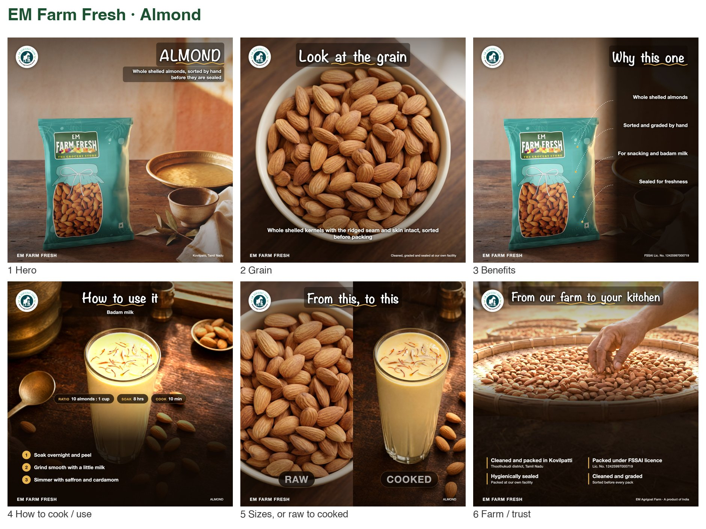

## Black Pepper
Listings: 100g (MASALA05_E2), 1Kg (MASALA05_E1), 300g (MASALA05_E3)

## Black Sesame
Listings: 100g (MASALA07_G2), 1Kg (MASALA07_G1), 300g (MASALA07_G3)

## Briyani Leaf
Listings:  (MASA08_H3),  (MASA08_H1)

## Cashew
Listings: 100g (SJ-K7R1-LY0C), 1Kg (JH-6KAG-0IPB)

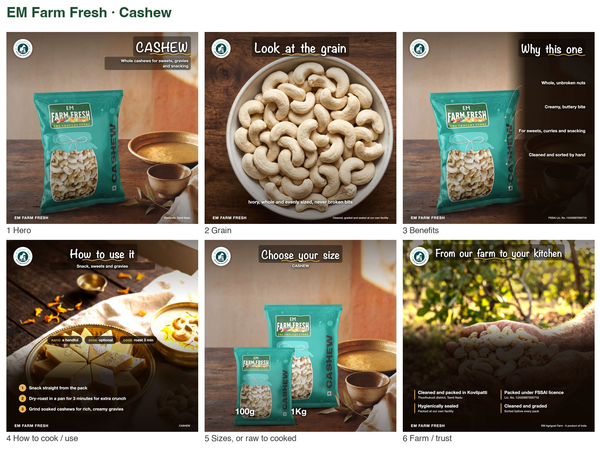

## Chana Dal
Listings: 500g (DAAL08_500gm), 1Kg (DAAL08_1Kg), 2Kg (DAAL08_500gmP4)

## Cinnamon
Listings: 100g (MASALA11_K2), 1Kg (MASALA11_K1), 300g (MASALA11_K3)

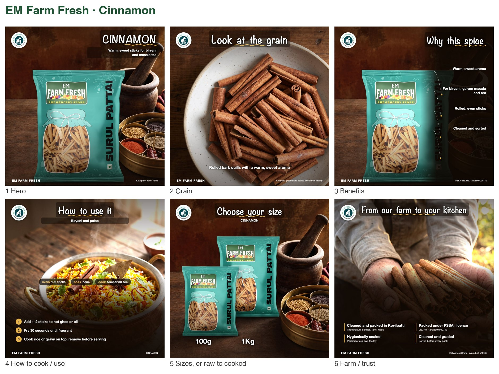

## Cloves
Listings:  (MASALA01_A3),  (MASALA01_A1)

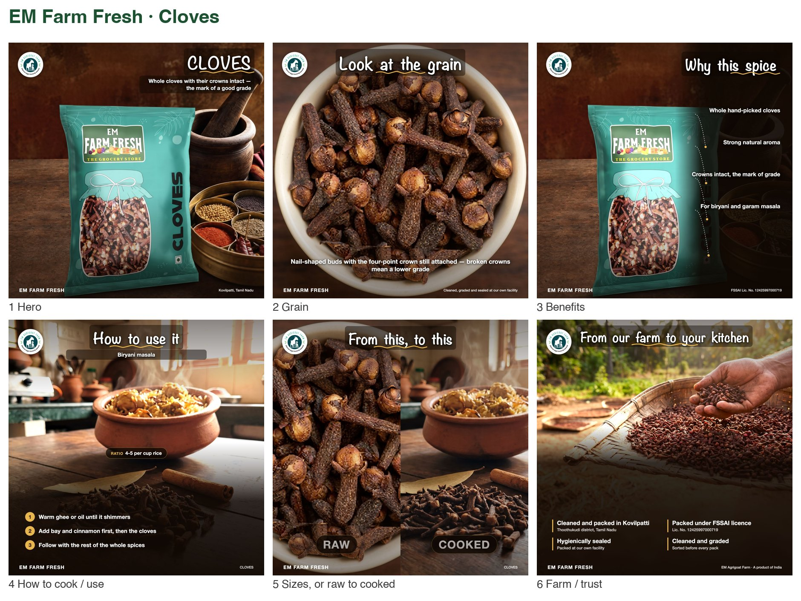

## Cumin Seeds
Listings: 100g (MASALA04_D2), 1Kg (MASALA04_D1), 300g (MASALA04_D3)

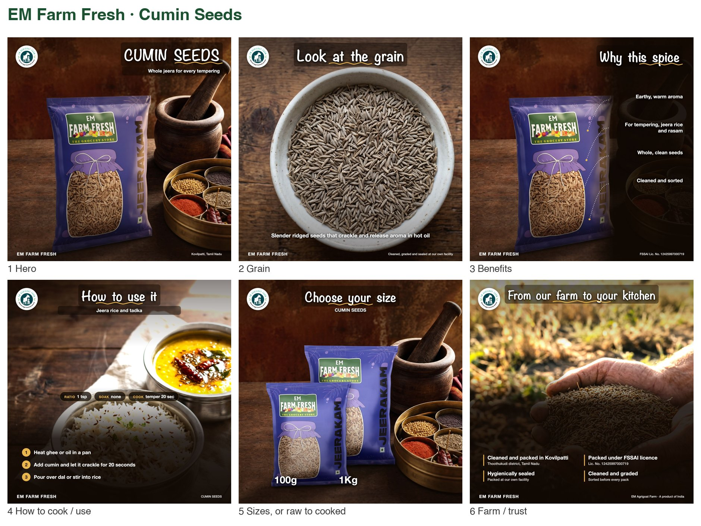

## Fennel Seeds
Listings: 100g (MASALA02_B2), 1Kg (MASALA02_B1), 300g (MASALA02_B3)

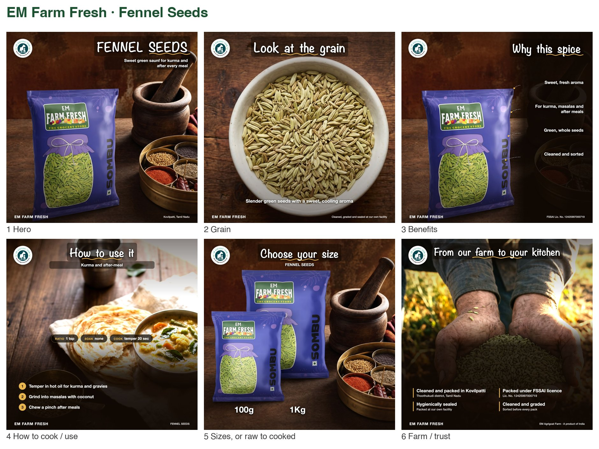

## Fenugreek Seeds
Listings: 100g (MASA03_C2), 1Kg (MASA03_C1), 300g (MASA03_C3)

## Fried Gram
Listings: 500g (DAAL13_500gm), 1Kg (DAAL13_1Kg), 2Kg (DAAL13_500gmP4)

## Green Moong
Listings:  (DAAL05_500gmP4)

## Green Peas
Listings: 500g (DAAL06_500gm), 1Kg (DAAL06_1Kg), 2Kg (DAAL06_500gmP4)

## Mappillai Samba
Listings:  (O0-XJ0G-5JWB)

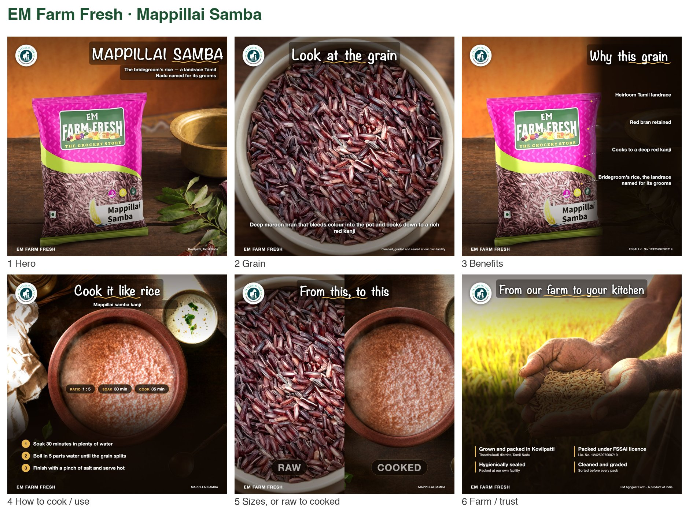

## Marathi Moggu
Listings: 100g (MASALA09_I2), 1Kg (MASALA09_I1), 300g (MASALA09_I3)

## Moong Dal
Listings:  (DAAL04_500gmP4)

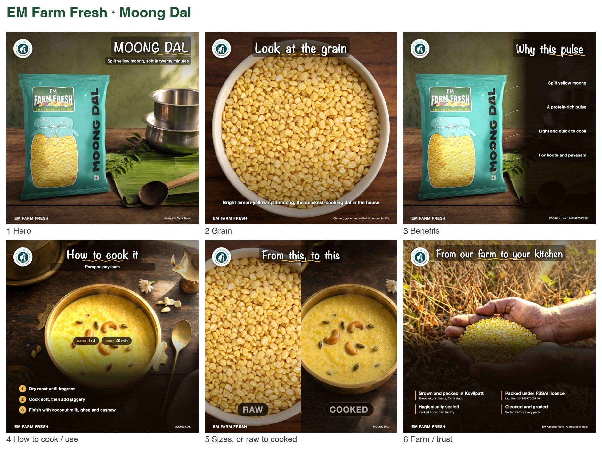

## Red Masoor Dal
Listings: 500g (DAAL03_500gm), 1Kg (DAAL03_1Kg), 2Kg (DAAL03_500gmP4)

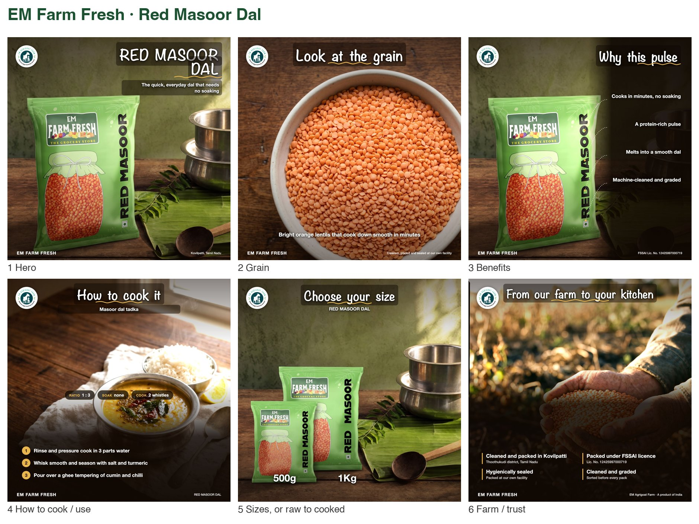

## Red Rajma
Listings: 500g (DAAL11_500gm), 1Kg (DAAL11_1Kg), 2Kg (4x500g) (DAAL11_500gmP4)

## Star Anise
Listings: 100g (MASALA10_J2), 1Kg (MASALA10_J1), 300g (MASALA10_J3)

## Toor Dal
Listings:  (DAAL01_500gmP4)

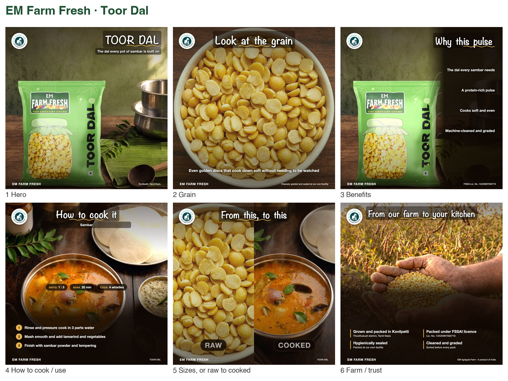

## Urad Dal
Listings:  (DAAL02_500gmP4),  (DAAL02_500gm)

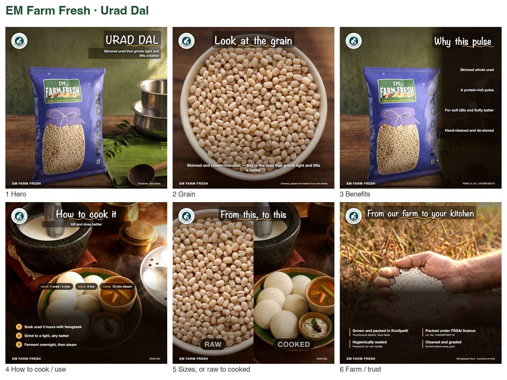

## White Sesame
Listings: 100g (MASALA06_F2), 1Kg (MASALA06_F1), 300g (MASALA06_F3)

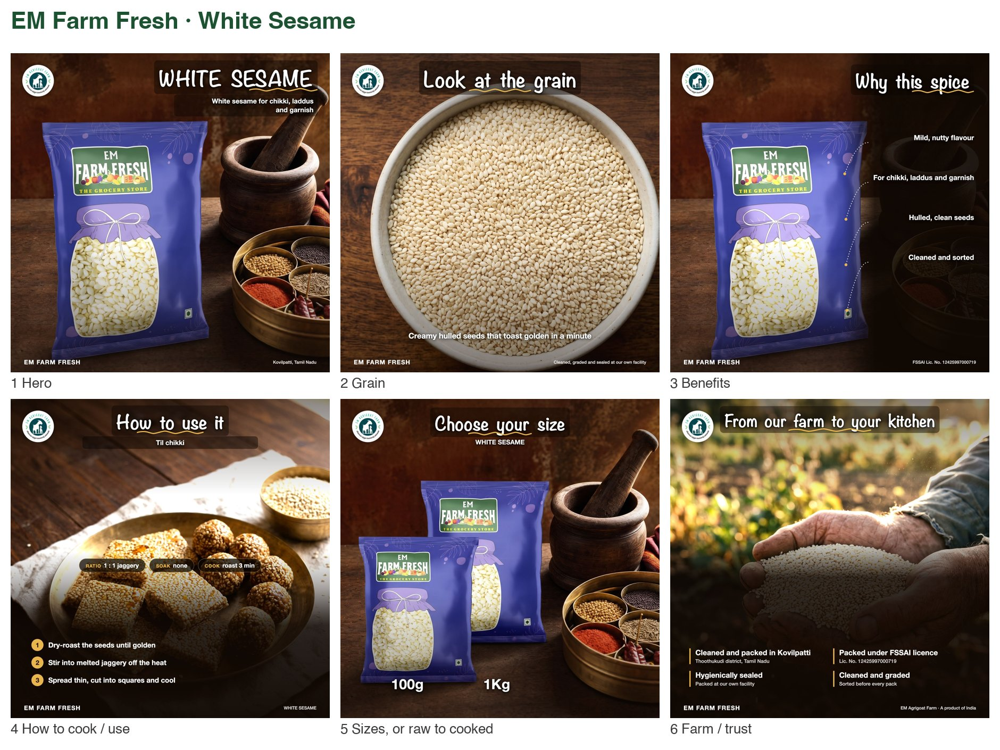

